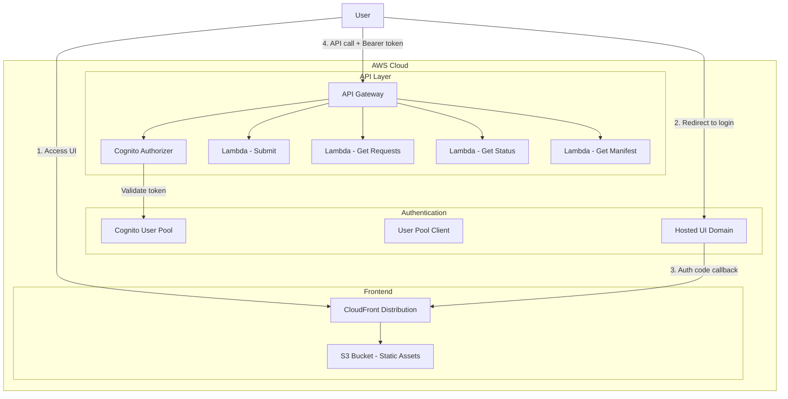
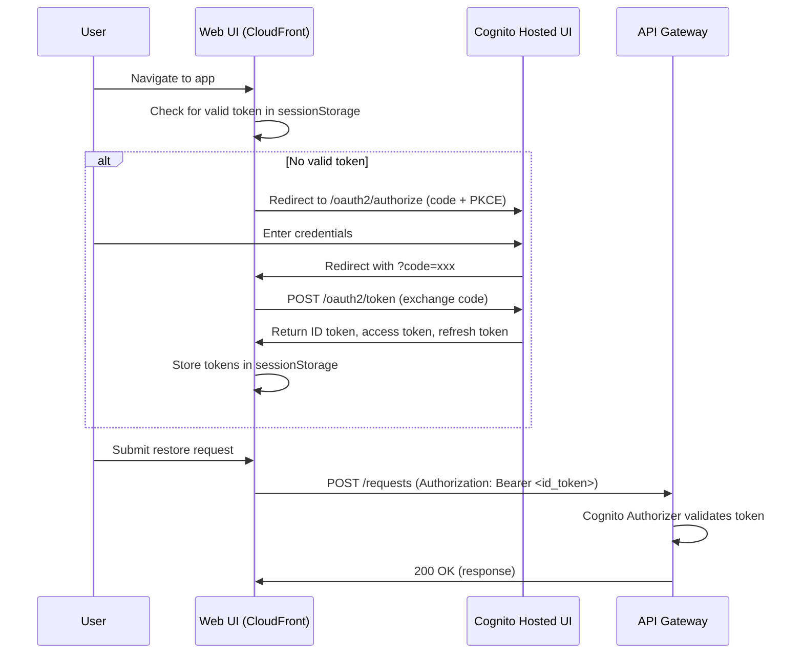

# Design Document: Cognito Authentication

## Overview

This design adds Amazon Cognito authentication to the Glacier Restore & DataSync application. A new `AuthConstruct` CDK construct provisions the Cognito User Pool (self-sign-up disabled), User Pool Client (authorization code + PKCE), and Hosted UI domain. The existing `ApiConstruct` is modified to attach a `CognitoUserPoolsAuthorizer` to all routes. The web UI is updated to redirect unauthenticated users to the Cognito Hosted UI, exchange authorization codes for tokens, include Bearer tokens on API requests, and handle token refresh and logout.

## Architecture



### Authentication Flow



## Components and Interfaces

### 1. AuthConstruct (`lib/constructs/auth-construct.ts`)

New CDK construct that provisions all Cognito resources.

**Props Interface:**
```typescript
export interface AuthConstructProps {
  /** CloudFront distribution URL for callback/logout URLs */
  callbackUrl: string;
}
```

**Exposed Properties:**
```typescript
export class AuthConstruct extends Construct {
  /** The Cognito User Pool */
  public readonly userPool: cognito.UserPool;
  /** The User Pool Client */
  public readonly userPoolClient: cognito.UserPoolClient;
  /** The Cognito domain prefix */
  public readonly userPoolDomain: cognito.UserPoolDomain;
  /** The full Cognito domain URL */
  public readonly cognitoDomainUrl: string;
}
```

**Responsibilities:**
- Create User Pool with `selfSignUpEnabled: false`
- Email as sign-in alias
- Password policy: min 8 chars, uppercase, lowercase, digits, symbols
- Create User Pool Client with authorization code grant, no client secret
- OAuth scopes: openid, email, profile
- Callback URL and logout URL = CloudFront URL
- Create Cognito domain (auto-generated prefix using stack name)

### 2. Modified ApiConstruct (`lib/constructs/api-construct.ts`)

**Updated Props Interface:**
```typescript
export interface ApiConstructProps {
  table: dynamodb.ITable;
  orchestratorFunction: lambda.IFunction;
  stagingBucket?: string;
  /** Cognito User Pool for API authorization */
  userPool?: cognito.IUserPool;
}
```

**Changes:**
- Accept optional `userPool` prop
- When provided, create a `CognitoUserPoolsAuthorizer`
- Attach authorizer to all `addMethod()` calls with `authorizationType: AuthorizationType.COGNITO`
- Update CORS `allowHeaders` to include `'Authorization'`

### 3. Modified WebUiConstruct (`lib/constructs/web-ui-construct.ts`)

**Updated Props Interface:**
```typescript
export interface WebUiConstructProps {
  apiUrl?: string;
  /** Cognito configuration for the web UI */
  cognitoConfig?: {
    userPoolId: string;
    userPoolClientId: string;
    cognitoDomain: string;
  };
}
```

**Changes:**
- When `cognitoConfig` is provided, include Cognito settings in the deployed `config.js`

### 4. Modified Web UI (`src/web-ui/`)

**New file: `src/web-ui/auth.js`**

Handles the authentication lifecycle:
- `initAuth()`: Check for tokens in sessionStorage or authorization code in URL params
- `redirectToLogin()`: Build Cognito `/oauth2/authorize` URL with PKCE parameters
- `handleCallback()`: Exchange authorization code for tokens via `/oauth2/token` endpoint
- `getIdToken()`: Return current valid ID token, refreshing if expired
- `logout()`: Clear sessionStorage, redirect to Cognito `/logout` endpoint
- `isAuthenticated()`: Check if a valid (non-expired) ID token exists
- `getUserEmail()`: Decode ID token to extract email claim

**PKCE Implementation:**
- Generate random `code_verifier` (43-128 character string)
- Compute `code_challenge` as Base64URL(SHA-256(code_verifier))
- Store `code_verifier` in sessionStorage during redirect
- Include `code_verifier` in token exchange request

**Modified: `src/web-ui/app.js`**

- On initialization, call `initAuth()` before loading the dashboard
- If not authenticated, call `redirectToLogin()` and halt further initialization
- Add Authorization header to all `fetch()` calls using `getIdToken()`
- Add logout button to the header with click handler calling `logout()`
- Display user email in the header from `getUserEmail()`

**Modified: `src/web-ui/index.html`**

- Add `<script src="auth.js"></script>` before `app.js`
- Add logout button and user email display to the header

### 5. Modified RestoreTransferStack (`lib/restore-transfer-stack.ts`)

**Changes:**
- Instantiate `AuthConstruct` after `WebUiConstruct` (needs CloudFront URL)
- Pass `callbackUrl: webUi.distributionUrl` to `AuthConstruct`
- Pass `userPool: auth.userPool` to `ApiConstruct`
- Pass `cognitoConfig` to `WebUiConstruct`
- Add CfnOutputs for User Pool ID and Client ID

**Ordering consideration:** The WebUi construct must be created first to get the CloudFront URL, then Auth construct uses that URL, then the config is deployed. This requires a two-phase approach for WebUiConstruct — create the distribution first, then deploy the config with Cognito settings. The existing `WebUiConstruct` already handles this via the `config.js` deployment source pattern.

## Data Models

### Token Storage (sessionStorage)

```
sessionStorage:
  cognito_id_token: string       // JWT ID token
  cognito_access_token: string   // JWT access token  
  cognito_refresh_token: string  // Opaque refresh token
  cognito_code_verifier: string  // PKCE code verifier (temporary, during auth flow)
  cognito_token_expiry: number   // Unix timestamp of ID token expiry
```

### config.js Structure (Updated)

```javascript
window.__CONFIG__ = {
  apiUrl: "https://xxx.execute-api.region.amazonaws.com/prod",
  cognito: {
    userPoolId: "us-west-2_xxxxxx",
    clientId: "xxxxxxxxxxxxxxxxxxxxxxxxxx",
    domain: "https://your-prefix.auth.us-west-2.amazoncognito.com",
    redirectUri: "https://dxxxxxxxxxxxxx.cloudfront.net",
    logoutUri: "https://dxxxxxxxxxxxxx.cloudfront.net"
  }
};
```

## Error Handling

| Scenario | Handling |
|----------|----------|
| No token on app load | Redirect to Cognito Hosted UI login |
| Token expired during API call | Attempt refresh; if refresh fails, redirect to login |
| 401 from API Gateway | Attempt token refresh; if still 401, redirect to login |
| Token exchange fails (invalid code) | Show error message, redirect to login after delay |
| Cognito domain already taken | CDK deployment fails with clear error; user must change prefix |
| CORS preflight missing Authorization | Updated CORS config includes Authorization header |
| Refresh token expired | Redirect to login page |

## Testing Strategy

### Assessment: Property-Based Testing Applicability

PBT is **not appropriate** for this feature because:

1. **Infrastructure as Code**: The core of this feature is CDK constructs (Cognito User Pool, Client, Authorizer). These are declarative configurations validated via CDK assertion tests and snapshot tests.
2. **Client-side auth flow**: The web UI auth logic (PKCE, token exchange, redirects) involves browser APIs and external Cognito service calls — not pure functions with universal properties over a large input space.
3. **Integration-heavy**: The value of testing comes from verifying that components are wired correctly (correct URLs, correct scopes, authorizer attached), which is best done with CDK assertion tests and integration tests.

### Testing Approach

**CDK Assertion Tests** (`test/unit/auth-construct.test.ts`):
- Verify User Pool is created with self-sign-up disabled
- Verify User Pool Client has correct OAuth settings (grant types, scopes, callback URLs)
- Verify Cognito domain is created
- Verify password policy is correctly configured

**CDK Assertion Tests** (`test/unit/api-construct.test.ts` — extended):
- Verify Cognito authorizer is attached to all API methods
- Verify CORS headers include Authorization
- Verify authorizer references the correct User Pool

**CDK Assertion Tests** (`test/unit/web-ui-construct.test.ts` — extended):
- Verify config.js includes Cognito settings when provided
- Verify config.js omits Cognito settings when not provided

**Integration Tests** (manual or E2E):
- Verify login redirect works
- Verify token exchange succeeds
- Verify authenticated API calls succeed
- Verify unauthenticated API calls return 401
- Verify logout clears session and redirects

**Unit Tests** (`test/unit/auth.test.ts` — for web UI auth module):
- Test `isAuthenticated()` with valid/expired/missing tokens
- Test `getUserEmail()` decodes JWT email claim correctly
- Test PKCE code challenge generation
- Test token expiry checking logic
