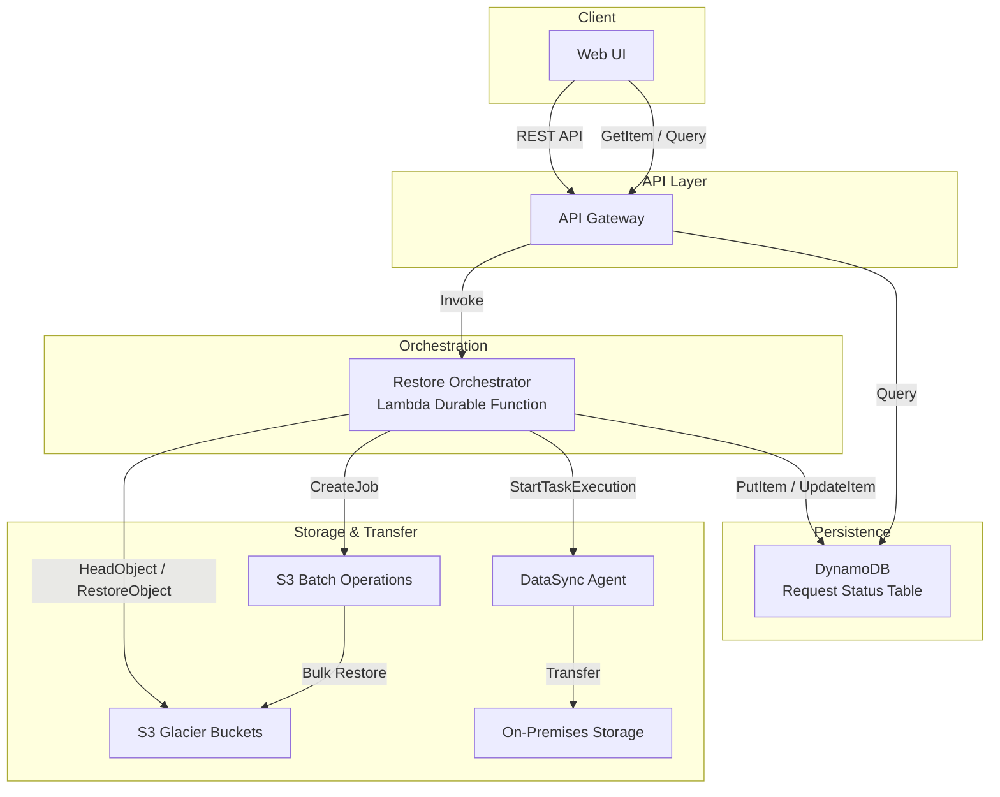
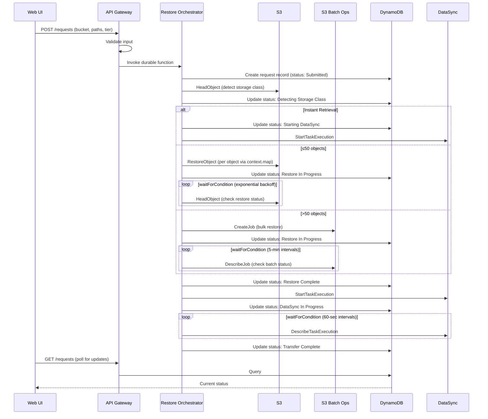
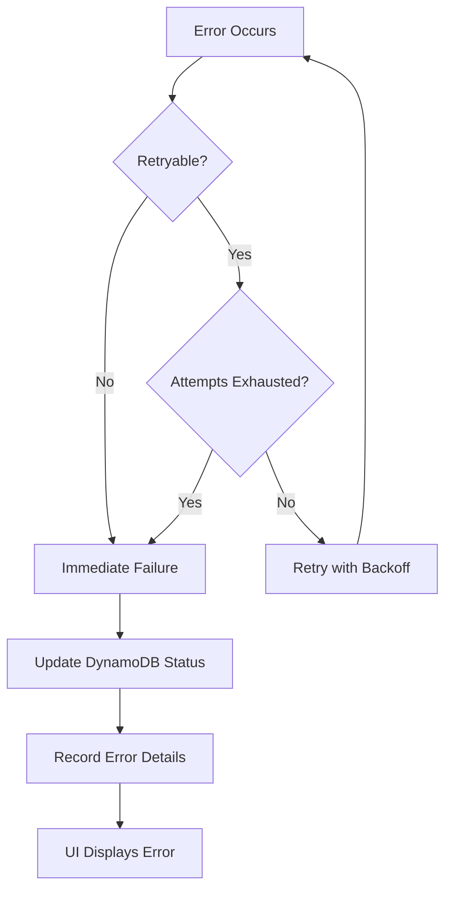

# Design Document: Glacier Restore DataSync

## Overview

This system orchestrates the end-to-end workflow of restoring objects from S3 Glacier storage classes and transferring them to on-premises storage via AWS DataSync. The architecture uses Lambda Durable Functions as the orchestration engine, which suspends execution during long Glacier restore waits (up to 48+ hours) without incurring compute charges. A lightweight web UI provides operators with real-time visibility into request progress.

The system handles three S3 Glacier storage classes with different retrieval characteristics:
- **Instant Retrieval**: Objects are directly accessible (no restore needed)
- **Flexible Retrieval**: Standard restores in 3-5 hours, Expedited in 1-5 minutes, Bulk in 5-12 hours
- **Deep Archive**: Standard restores in up to 12 hours, Bulk in up to 48 hours (Expedited not available)

For bulk operations (50+ objects), the system leverages S3 Batch Operations to reduce per-request overhead and cost.

### Key Design Decisions

1. **Lambda Durable Functions over Step Functions**: Durable Functions provide native code-level orchestration with `waitForCondition` for polling and `context.map` for batch processing, avoiding the state machine definition overhead of Step Functions while still suspending during idle waits.

2. **S3 Batch Operations threshold at 50 objects**: Below 50 objects, individual RestoreObject calls via `context.map` are simpler and provide per-object status tracking. Above 50, Batch Operations reduce API call overhead and cost.

3. **Polling over EventBridge notifications**: S3 restore completion does not emit native EventBridge events for all storage classes. Polling with exponential backoff via `waitForCondition` provides a reliable, universal approach.

4. **DynamoDB for request persistence**: Provides single-digit millisecond reads for the UI status polling pattern and supports TTL for automatic cleanup of old requests.

5. **AWS CDK (TypeScript) for Infrastructure as Code**: All AWS resources are defined and deployed using AWS CDK v2 with TypeScript. This provides type-safe infrastructure definitions, reusable constructs, and a unified language across both infrastructure and application code.

### Technology Stack

| Layer | Technology |
|-------|-----------|
| Language | TypeScript (application and infrastructure) |
| Infrastructure as Code | AWS CDK v2 (TypeScript) |
| Orchestration Runtime | Lambda Durable Functions (`@aws/durable-execution-sdk-js`) |
| API Layer | API Gateway REST API (defined via CDK `RestApi` construct) |
| Persistence | DynamoDB (defined via CDK `Table` construct) |
| Web UI Hosting | S3 bucket + CloudFront distribution (defined via CDK) |
| Testing | Jest + fast-check (property-based tests) |
| Build | esbuild (Lambda bundling via CDK `NodejsFunction`) |

### CDK Project Structure

```
├── bin/
│   └── glacier-restore-datasync.ts       # CDK app entry point
├── lib/
│   ├── glacier-restore-datasync-stack.ts  # Main CDK stack
│   ├── constructs/
│   │   ├── api-construct.ts              # API Gateway + Lambda integrations
│   │   ├── orchestrator-construct.ts     # Durable Function Lambda + IAM
│   │   ├── persistence-construct.ts      # DynamoDB table + GSI
│   │   └── web-ui-construct.ts           # S3 + CloudFront for static UI
│   └── config/
│       └── environment.ts                # Environment-specific configuration
├── src/
│   ├── orchestrator/
│   │   ├── handler.ts                    # Durable Function handler
│   │   ├── steps/
│   │   │   ├── detect-storage-class.ts   # HeadObject logic
│   │   │   ├── initiate-restore.ts       # RestoreObject / Batch Operations
│   │   │   ├── monitor-restore.ts        # Polling logic
│   │   │   ├── start-datasync.ts         # DataSync task execution
│   │   │   └── monitor-datasync.ts       # DataSync polling
│   │   └── utils/
│   │       ├── retry.ts                  # Exponential backoff utilities
│   │       └── status.ts                 # Status update helpers
│   ├── api/
│   │   ├── submit-request.ts            # POST /requests handler
│   │   ├── get-requests.ts              # GET /requests handler
│   │   └── get-request-status.ts        # GET /requests/{id} handler
│   ├── shared/
│   │   ├── types.ts                     # Shared TypeScript interfaces
│   │   ├── validation.ts               # Input validation logic
│   │   └── constants.ts                # Timeouts, thresholds, status values
│   └── web-ui/
│       ├── index.html                   # Single-page application
│       ├── app.js                       # UI logic (vanilla JS)
│       └── styles.css                   # Styling
├── test/
│   ├── unit/
│   │   ├── validation.test.ts
│   │   ├── retry.test.ts
│   │   └── status.test.ts
│   ├── property/
│   │   ├── validation.property.test.ts
│   │   ├── backoff.property.test.ts
│   │   ├── routing.property.test.ts
│   │   └── formatting.property.test.ts
│   └── integration/
│       └── orchestrator.integration.test.ts
├── cdk.json
├── tsconfig.json
├── package.json
└── jest.config.ts
```

## Architecture



### Workflow Sequence



## Components and Interfaces

### 1. Web UI

A lightweight single-page application that provides:
- Restore request submission form (bucket, file paths, retrieval tier)
- Real-time status dashboard with auto-refresh
- Request history with filtering

**Technology**: Static HTML/JS hosted on S3 + CloudFront (deployed via CDK `BucketDeployment` and `Distribution` constructs)

### 2. API Gateway

REST API with the following endpoints:

| Method | Path | Description |
|--------|------|-------------|
| POST | /requests | Submit a new restore request |
| GET | /requests | List recent requests (with optional status filter) |
| GET | /requests/{requestId} | Get status of a specific request |

**Request Validation** (performed at API Gateway level):
- `bucket`: non-empty string, 3-63 characters
- `filePaths`: array of 1-1000 non-empty strings, each ≤1024 characters
- `retrievalTier`: one of `Expedited`, `Standard`, `Bulk`

### 3. Restore Orchestrator (Lambda Durable Function)

The core orchestration component implemented using the AWS Durable Execution SDK (TypeScript). It coordinates the full lifecycle:

```typescript
export const handler = withDurableExecution(
  async (event: RestoreRequest, context: DurableContext) => {
    // Step 1: Persist initial request
    await context.step("persist-request", async () => persistToDynamo(event));

    // Step 2: Detect storage classes
    const classResults = await context.map(
      "detect-storage-classes",
      event.filePaths,
      async (ctx, filePath) => ctx.step("head-object", () => headObject(event.bucket, filePath)),
      { maxConcurrency: 50 }
    );

    // Step 3: Initiate restores (skip Instant Retrieval objects)
    const objectsToRestore = classResults.filter(needsRestore);

    if (objectsToRestore.length > 50) {
      // Use S3 Batch Operations
      const jobId = await context.step("create-batch-job", () => createBatchJob(objectsToRestore));
      await context.waitForCondition("wait-batch-complete", ...);
    } else if (objectsToRestore.length > 0) {
      // Use context.map for individual restores
      await context.map("restore-objects", objectsToRestore, ...);
      await context.waitForCondition("wait-restore-complete", ...);
    }

    // Step 4: Start DataSync
    const taskArn = await context.step("start-datasync", () => startDataSync(...));

    // Step 5: Wait for DataSync completion
    await context.waitForCondition("wait-datasync-complete", ...);

    // Step 6: Mark complete
    await context.step("mark-complete", () => updateStatus("Transfer Complete"));
  }
);
```

### 4. S3 Batch Operations Integration

For requests with more than 50 objects:
1. Generate a CSV manifest listing all object keys
2. Upload manifest to a staging S3 bucket
3. Create a Batch Operations job with `S3InitiateRestoreObject` operation
4. Poll job status via `DescribeJob` until completion

### 5. DataSync Integration

After restore completion:
1. Start a DataSync task execution targeting the restored objects
2. The DataSync agent (pre-configured on-premises) handles the actual file transfer
3. Poll task execution status until terminal state

### 6. DynamoDB Request Store

Provides persistence for request metadata and status, enabling the UI to display real-time progress without coupling to the orchestrator's internal state.

## Data Models

### RestoreRequest (API Input)

```typescript
interface RestoreRequest {
  bucket: string;          // S3 bucket name (3-63 chars)
  filePaths: string[];     // Array of S3 object keys (1-1000 items, each ≤1024 chars)
  retrievalTier: "Expedited" | "Standard" | "Bulk";
}
```

### RestoreRequestRecord (DynamoDB)

```typescript
interface RestoreRequestRecord {
  requestId: string;           // Partition key (ULID for time-ordered uniqueness)
  bucket: string;
  filePaths: string[];
  retrievalTier: "Expedited" | "Standard" | "Bulk";
  status: RequestStatus;
  submittedAt: string;         // ISO 8601 timestamp
  completedAt?: string;        // ISO 8601 timestamp
  batchJobId?: string;         // S3 Batch Operations job ID (if batch)
  dataSyncTaskArn?: string;    // DataSync task execution ARN
  objectCount: number;         // Total objects in request
  restoredCount: number;       // Objects successfully restored
  errorDetails?: ErrorDetail[];
  ttl: number;                 // DynamoDB TTL (30 days after completion)
}

type RequestStatus =
  | "Submitted"
  | "Detecting Storage Class"
  | "Initiating Restore"
  | "Restore In Progress"
  | "Restore Complete"
  | "Starting DataSync"
  | "DataSync In Progress"
  | "Transfer Complete"
  | "Restore Timed Out"
  | "DataSync Failed"
  | "Transfer Timed Out"
  | "Transfer Status Unknown"
  | "Error";

interface ErrorDetail {
  filePath: string;
  step: string;
  reason: string;
  timestamp: string;
}
```

### DynamoDB Table Design

| Attribute | Type | Key |
|-----------|------|-----|
| requestId | String | Partition Key |
| submittedAt | String | Sort Key (GSI) |
| status | String | GSI Partition Key |

**Global Secondary Index (StatusIndex)**:
- Partition Key: `status`
- Sort Key: `submittedAt`
- Projection: ALL

This supports the UI's query patterns: list recent requests (scan by submittedAt) and filter by status (query StatusIndex).

### StorageClassInfo (Internal)

```typescript
interface StorageClassInfo {
  filePath: string;
  storageClass: "GLACIER" | "DEEP_ARCHIVE" | "GLACIER_IR";
  exists: boolean;
  error?: string;
}
```

### Retrieval Tier Constraints

| Storage Class | Expedited | Standard | Bulk |
|---------------|-----------|----------|------|
| Flexible Retrieval | 1-5 min | 3-5 hours | 5-12 hours |
| Deep Archive | ❌ Not available | Up to 12 hours | Up to 48 hours |
| Instant Retrieval | N/A (direct access) | N/A | N/A |

### Timeout Configuration

| Tier | Max Wait Duration |
|------|-------------------|
| Expedited | 12 hours |
| Standard | 48 hours |
| Bulk | 72 hours |
| DataSync Transfer | 60 minutes |


## Correctness Properties

*A property is a characteristic or behavior that should hold true across all valid executions of a system—essentially, a formal statement about what the system should do. Properties serve as the bridge between human-readable specifications and machine-verifiable correctness guarantees.*

### Property 1: Input validation correctness

*For any* string `bucket`, string `filePath`, and string `tier`, the validation function SHALL accept the input if and only if `bucket` is between 3 and 63 characters (non-empty), `filePath` is between 1 and 1024 characters, and `tier` is one of "Expedited", "Standard", or "Bulk". When validation fails, the error response SHALL correctly identify which field failed and the reason.

**Validates: Requirements 1.2, 1.3**

### Property 2: Tier availability by storage class

*For any* storage class and retrieval tier combination, when the storage class is Deep Archive, the set of available tiers SHALL NOT include Expedited. If Expedited was previously selected and the storage class changes to Deep Archive, the selection SHALL reset to Standard.

**Validates: Requirements 2.2**

### Property 3: Exponential backoff retry

*For any* sequence of transient/throttling errors with a configured max attempt count `N` and base delay `B`, the retry mechanism SHALL attempt at most `N` retries with delays following the pattern `B * 2^attempt` seconds, and SHALL report failure with the correct error details after exhausting all attempts.

**Validates: Requirements 3.4, 4.4**

### Property 4: Non-retryable error classification

*For any* error that is not a throttling or transient error (e.g., AccessDenied, NoSuchKey, InvalidRequest), the system SHALL NOT retry the operation and SHALL immediately mark the request as failed with the object key and failure reason.

**Validates: Requirements 4.6**

### Property 5: Restore routing by storage class

*For any* object with a detected storage class, if the class is Instant Retrieval the system SHALL skip the restore step, and if the class is Deep Archive or Flexible Retrieval the system SHALL proceed to the Glacier restore step with the selected retrieval tier.

**Validates: Requirements 3.5, 3.6**

### Property 6: Batch operations threshold

*For any* set of objects requiring restore, if the count exceeds 50 the system SHALL use S3 Batch Operations, and if the count is 50 or fewer the system SHALL use individual RestoreObject calls via context.map.

**Validates: Requirements 4.2**

### Property 7: Restore polling backoff calculation

*For any* polling attempt number `n` (starting at 0), the delay before the next poll SHALL be `min(5 * 2^n, 30)` minutes.

**Validates: Requirements 5.1, 11.2**

### Property 8: Tier-to-timeout mapping

*For any* retrieval tier, the maximum restore wait duration SHALL be: 12 hours for Expedited, 48 hours for Standard, and 72 hours for Bulk. If the restore exceeds this duration, the status SHALL become "Restore Timed Out".

**Validates: Requirements 5.4**

### Property 9: Consecutive polling failure detection

*For any* sequence of polling results (success or transient failure), the system SHALL update the status to "Transfer Status Unknown" if and only if 3 or more consecutive transient failures occur. A successful poll SHALL reset the consecutive failure counter.

**Validates: Requirements 7.5**

### Property 10: Elapsed time formatting

*For any* non-negative duration in seconds, the formatted string SHALL follow the pattern "Xd Xh Xm Xs" where zero-value leading units are omitted (e.g., 3661 seconds → "1h 1m 1s", 90061 seconds → "1d 1h 1m 1s", 5 seconds → "5s").

**Validates: Requirements 8.3**

### Property 11: Path deduplication and count validation

*For any* list of file paths submitted by the operator, the system SHALL remove duplicate entries and accept the request if and only if the resulting unique path count is between 2 and 1000 (inclusive).

**Validates: Requirements 9.1**

### Property 12: Partial batch validation

*For any* batch of file paths where some objects exist and some do not, the system SHALL report all missing object paths to the operator and create a batch job containing only the existing objects. If no objects exist, no batch job SHALL be created.

**Validates: Requirements 9.4, 9.5**

### Property 13: Request persistence completeness

*For any* request state change, the persisted DynamoDB record SHALL contain all required fields: bucket, filePaths, retrievalTier, status, and submittedAt. After completion, the record SHALL also contain completedAt.

**Validates: Requirements 10.1**

### Property 14: Request query correctness

*For any* set of persisted requests and any combination of status filters, the query results SHALL be ordered by submission time descending (newest first), contain at most 50 items, and when filters are applied, include only requests whose status matches one of the selected filter values.

**Validates: Requirements 10.2, 10.3**

### Property 15: Batch partial failure resilience

*For any* batch of files being processed where a subset of individual file restores fail or time out, the system SHALL continue processing all remaining files and report per-file success or failure status upon batch completion.

**Validates: Requirements 11.5**

## Error Handling

### Error Categories

| Category | Examples | Behavior |
|----------|----------|----------|
| Validation Error | Invalid bucket name, empty path, invalid tier | Immediate rejection with field-specific error message |
| Object Not Found (404) | HeadObject returns 404 | Immediate failure, no retry |
| Access Denied (403) | HeadObject returns 403 | Immediate failure, no retry |
| Throttling Error | S3 rate limiting | Retry with exponential backoff (up to 5 attempts) |
| Transient Error | Network timeout, 500/503 | Retry with exponential backoff (up to 3 attempts) |
| Restore Timeout | Restore exceeds tier-specific max duration | Mark as "Restore Timed Out", cease polling |
| DataSync Start Failure | StartTaskExecution fails | Retry up to 3 times (2s base backoff), then "DataSync Failed" |
| DataSync Transfer Failure | Task reports failed status | Mark as "DataSync Failed", record ARN and reason |
| DataSync Timeout | Transfer exceeds 60 minutes | Mark as "Transfer Timed Out", cease polling |
| Persistence Failure | DynamoDB write fails | Retry 3 times with backoff, log error, notify operator |

### Retry Strategy Summary

| Operation | Max Attempts | Base Delay | Backoff | Max Delay |
|-----------|-------------|------------|---------|-----------|
| HeadObject (transient) | 3 | 1 second | 2x | 4 seconds |
| RestoreObject (throttle) | 5 | 1 second | 2x | 16 seconds |
| DataSync start | 3 | 2 seconds | 2x | 8 seconds |
| DynamoDB write | 3 | 1 second | 2x | 4 seconds |
| Restore status poll | Continuous | 5 minutes | 2x | 30 minutes |
| DataSync status poll | Continuous | 60 seconds | 1x (fixed) | 60 seconds |

### Partial Failure Handling

For batch operations, the system follows a "best effort" approach:
- Individual file failures do not abort the entire batch
- Per-file status is tracked and reported
- The batch is considered complete when all files reach a terminal state (success, failed, or timed out)
- Missing objects are excluded from the batch job but reported to the operator

### Error Propagation



## Testing Strategy

### Unit Tests

Unit tests cover specific examples, edge cases, and error conditions:

- **Validation logic**: Specific valid/invalid input examples (empty strings, boundary lengths, invalid tier values)
- **Storage class routing**: Each storage class routes to the correct path
- **Error classification**: Specific error types are correctly categorized as retryable vs non-retryable
- **Status transitions**: Each valid state transition produces the correct next state
- **Time formatting**: Specific duration values produce expected formatted strings
- **DynamoDB record construction**: Records contain all required fields

### Property-Based Tests

Property-based tests verify universal properties across randomly generated inputs. Each property test runs a minimum of 100 iterations.

**Library**: [fast-check](https://github.com/dubzzz/fast-check) (TypeScript)

**Configuration**:
- Minimum 100 iterations per property
- Each test tagged with property reference

**Properties to implement**:

| Property | Generator Strategy |
|----------|-------------------|
| Property 1: Input validation | Random strings of varying lengths (0-100 chars), random tier strings |
| Property 2: Tier availability | Random storage class + tier combinations |
| Property 3: Exponential backoff | Random error sequences (1-10 attempts), random base delays |
| Property 4: Non-retryable errors | Random non-throttling error types from a known set |
| Property 5: Restore routing | Random storage class values |
| Property 6: Batch threshold | Random object counts (1-1500) |
| Property 7: Polling backoff | Random attempt numbers (0-50) |
| Property 8: Tier-to-timeout | Random tier values |
| Property 9: Consecutive failures | Random sequences of success/failure poll results |
| Property 10: Time formatting | Random non-negative integers (0 to 7 days in seconds) |
| Property 11: Path deduplication | Random string arrays with duplicates (0-2000 items) |
| Property 12: Partial batch validation | Random object lists with random existence flags |
| Property 13: Persistence completeness | Random request metadata objects |
| Property 14: Query correctness | Random request sets with random timestamps and status filters |
| Property 15: Batch resilience | Random batch sizes with random failure subsets |

**Tag format**: `Feature: glacier-restore-datasync, Property {N}: {title}`

### Integration Tests

Integration tests verify end-to-end behavior with real or mocked AWS services:

- API Gateway request routing and Lambda invocation
- S3 HeadObject and RestoreObject API calls with correct parameters
- S3 Batch Operations job creation and manifest upload
- DataSync task execution start and status polling
- DynamoDB read/write operations
- Web UI polling and status display updates

### End-to-End Tests

A small set of end-to-end tests against a staging environment:

1. Single file restore from Flexible Retrieval (Standard tier) → DataSync transfer
2. Batch restore (>50 files) from Deep Archive (Bulk tier) → DataSync transfer
3. Instant Retrieval file → direct DataSync transfer (no restore wait)
4. Mixed batch with some missing objects → partial success reporting
