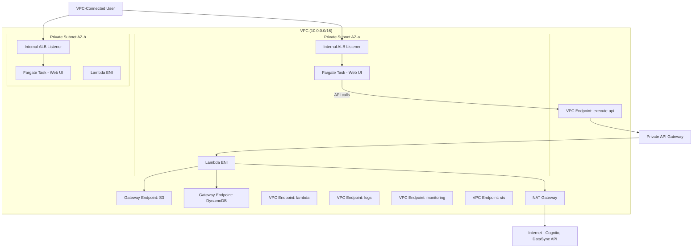

# Design Document: VPC Private Hosting

## Overview

This design migrates the S3 Glacier Restore and Transfer Orchestrator from a public internet-facing architecture to a fully VPC-private deployment. The migration involves:

1. **Removing** CloudFront + S3 static hosting (`WebUiConstruct`)
2. **Introducing** a VPC with private subnets, NAT Gateway, and VPC Endpoints (`VpcConstruct`)
3. **Introducing** an ECS Fargate service behind an internal ALB to serve the web UI (`VpcWebUiConstruct`)
4. **Converting** the public REST API Gateway to a Private API Gateway with resource policy enforcement
5. **Placing** all Lambda functions inside the VPC with appropriate security groups
6. **Adapting** Cognito callback/logout URLs to point at the internal ALB

The result is a system with zero public-facing endpoints — accessible only from VPC-connected workstations (e.g., via VPN, Direct Connect, or a bastion within the VPC).

## Architecture



### Key Design Decisions

1. **Bring Your Own VPC vs. Create New** — The `VpcConstruct` supports both modes: passing an existing VPC (via `existingVpc` prop) skips VPC/subnet/NAT creation entirely, while omitting it triggers full VPC provisioning. This allows teams with pre-existing network infrastructure (shared VPCs, Transit Gateway attachments, custom CIDR schemes) to integrate without duplicating network resources. When an existing VPC is used, the construct still creates VPC Endpoints and security groups within it.

2. **Single NAT Gateway** — Cost optimization for a non-mission-critical internal tool. If one AZ's NAT fails, outbound internet calls (DataSync API, Cognito token endpoints) are disrupted but VPC Endpoint-routed calls (S3, DynamoDB) continue working.

3. **Internal ALB with HTTPS** — Requires an ACM certificate. The certificate domain must match the ALB DNS name or a custom internal domain. Since this is VPC-private, a private hosted zone with a friendly CNAME pointing to the ALB is recommended but not strictly required.

4. **Fargate for Web UI** — Nginx container serving static files. Chosen over Lambda@Edge/ALB Lambda targets because: (a) eliminates all public-facing resources, (b) provides simple HTTP serving without cold starts, (c) allows runtime config injection via environment variables at container startup.

5. **Private API Gateway** — Uses VPC Endpoint for `execute-api` with a resource policy restricting access to requests from that VPC Endpoint. The Fargate container calls the API through this endpoint.

6. **Lambda in VPC** — All Lambda functions placed in private subnets with a dedicated security group. Gateway VPC endpoints handle S3 and DynamoDB traffic (no NAT cost). Other AWS API calls route through NAT.

## Components and Interfaces

### VpcConstruct

**File:** `lib/constructs/vpc-construct.ts`

Encapsulates all networking resources. Supports two modes of operation:
1. **Bring Your Own VPC** — caller provides an existing VPC (via `existingVpc`); the construct skips VPC/subnet/NAT creation and uses the provided VPC for all downstream resources.
2. **Create New VPC** — if no existing VPC is provided, the construct creates all networking resources from scratch (current default behavior).

```typescript
export interface VpcConstructProps {
  /**
   * An existing VPC to use instead of creating a new one.
   * When provided, the construct will NOT create a VPC, subnets, or NAT Gateway.
   * The provided VPC must have at least 2 private subnets in separate AZs.
   */
  existingVpc?: ec2.IVpc;
  /** Maximum number of AZs to use when creating a new VPC (default: 2). Ignored if existingVpc is provided. */
  maxAzs?: number;
  /** Number of NAT Gateways when creating a new VPC (default: 1). Ignored if existingVpc is provided. */
  natGateways?: number;
}

export class VpcConstruct extends Construct {
  /** The VPC (either imported or newly created) */
  public readonly vpc: ec2.IVpc;
  /** Security group for Lambda functions */
  public readonly lambdaSecurityGroup: ec2.SecurityGroup;
  /** Security group for VPC Endpoints */
  public readonly vpcEndpointSecurityGroup: ec2.SecurityGroup;
  /** The execute-api VPC Endpoint */
  public readonly executeApiEndpoint: ec2.InterfaceVpcEndpoint;
}
```

**Responsibilities:**

*When `existingVpc` is NOT provided (create mode):*
- Provisions VPC with /16 CIDR (10.0.0.0/16), 2 AZs, PRIVATE_WITH_EGRESS subnets only
- Creates 1 NAT Gateway

*When `existingVpc` IS provided (import mode):*
- Uses the provided VPC reference directly
- Validates at synthesis time that the VPC has at least 2 private subnets in separate AZs; throws a descriptive error if validation fails
- Does NOT create a VPC, subnets, or NAT Gateway (assumes the existing VPC already has these)

*In both modes:*
- Creates gateway endpoints for S3 and DynamoDB
- Creates interface endpoints for execute-api, lambda, logs, monitoring, sts
- Creates security groups for VPC endpoints and Lambda functions
- Configures VPC endpoint security groups to allow inbound 443 from VPC CIDR

### VpcWebUiConstruct

**File:** `lib/constructs/vpc-web-ui-construct.ts`

Replaces `WebUiConstruct`. Serves the web UI via Fargate + internal ALB.

```typescript
export interface VpcWebUiConstructProps {
  /** The VPC to deploy into */
  vpc: ec2.IVpc;
  /** API Gateway invoke URL (injected as runtime config) */
  apiUrl: string;
  /** Cognito configuration for auth */
  cognitoConfig: {
    userPoolId: string;
    userPoolClientId: string;
    cognitoDomain: string;
  };
  /** ACM certificate ARN for HTTPS on the ALB */
  certificateArn: string;
}

export class VpcWebUiConstruct extends Construct {
  /** The internal ALB */
  public readonly loadBalancer: elbv2.ApplicationLoadBalancer;
  /** The ALB DNS name */
  public readonly albDnsName: string;
  /** The full HTTPS URL of the ALB */
  public readonly albUrl: string;
  /** The ECS Fargate service */
  public readonly service: ecs.FargateService;
}
```

**Responsibilities:**
- Creates an ECS Cluster
- Builds a Docker image from `src/web-ui/` with an nginx base, copying static files into `/usr/share/nginx/html/`
- Injects `config.js` at container startup via an entrypoint script that reads environment variables and writes the config file
- Creates a Fargate service with 2 desired tasks across 2 AZs
- Creates an internal ALB (scheme: internal) with HTTPS listener on 443
- Configures health checks at path "/" with 30s interval, 2 healthy / 3 unhealthy thresholds
- Security group: ALB allows inbound 443 from VPC CIDR; Fargate allows inbound 80 from ALB SG only

### Modified ApiConstruct

**File:** `lib/constructs/api-construct.ts` (modified)

Changes the existing REST API from public to private.

```typescript
export interface ApiConstructProps {
  /** DynamoDB table */
  table: dynamodb.ITable;
  /** Orchestrator Lambda function */
  orchestratorFunction: lambda.IFunction;
  /** Staging bucket name */
  stagingBucket?: string;
  /** Cognito User Pool */
  userPool?: cognito.IUserPool;
  /** VPC for Lambda placement */
  vpc?: ec2.IVpc;
  /** Security group for Lambda functions */
  lambdaSecurityGroup?: ec2.ISecurityGroup;
  /** VPC Endpoint ID for execute-api (required for private API) */
  vpcEndpointId?: string;
}
```

**Key Modifications:**
- REST API configured with `endpointTypes: [apigateway.EndpointType.PRIVATE]`
- Resource policy added restricting `execute-api:Invoke` to the specified VPC Endpoint
- All Lambda functions configured with `vpc` and `securityGroups` properties
- Lambda execution roles granted ENI management permissions automatically by CDK
- CORS `allowOrigins` scoped to the internal ALB URL

### Modified OrchestratorConstruct

**File:** `lib/constructs/orchestrator-construct.ts` (modified)

```typescript
export interface OrchestratorConstructProps {
  // ... existing props ...
  /** VPC for Lambda placement */
  vpc?: ec2.IVpc;
  /** Security group for Lambda functions */
  lambdaSecurityGroup?: ec2.ISecurityGroup;
}
```

**Key Modifications:**
- Orchestrator Lambda configured with `vpc` and `securityGroups` properties
- No other behavioral changes — the function's AWS SDK calls route through VPC endpoints (S3, DynamoDB) or NAT (DataSync)

### Modified AuthConstruct

**File:** `lib/constructs/auth-construct.ts` (modified)

```typescript
export interface AuthConstructProps {
  /** Internal ALB URL for callback/logout URLs */
  callbackUrl: string;
}
```

**Key Modification:**
- `callbackUrl` now receives the ALB HTTPS URL instead of the CloudFront distribution URL
- No structural changes to Cognito resources

### Modified RestoreTransferStack

**File:** `lib/restore-transfer-stack.ts` (modified)

**Key Changes:**
- Instantiates `VpcConstruct` first, passing `existingVpc` (looked up via `Vpc.fromLookup` when `existingVpcId` is set in environment config) or omitting it to trigger VPC creation
- Passes VPC and security group references to `ApiConstruct`, `OrchestratorConstruct`, and `VpcWebUiConstruct`
- Replaces `WebUiConstruct` with `VpcWebUiConstruct`
- Uses `Lazy.string` for ALB URL in `AuthConstruct` (same pattern as current CloudFront URL circular reference)
- Removes `WebUiUrl` CloudFront output, adds `AlbDnsName` output
- Adds `certificateArn` and optional `existingVpcId` to environment config

### Web UI Container (Dockerfile)

**File:** `src/web-ui/Dockerfile`

```dockerfile
FROM public.ecr.aws/nginx/nginx:1-alpine
COPY . /usr/share/nginx/html/
COPY docker-entrypoint.sh /docker-entrypoint.d/40-inject-config.sh
RUN chmod +x /docker-entrypoint.d/40-inject-config.sh
EXPOSE 80
```

**File:** `src/web-ui/docker-entrypoint.sh`

```bash
#!/bin/sh
# Inject runtime configuration from environment variables
cat > /usr/share/nginx/html/config.js << EOF
window.__CONFIG__ = {
  "apiUrl": "${API_URL}",
  "cognito": {
    "userPoolId": "${COGNITO_USER_POOL_ID}",
    "clientId": "${COGNITO_CLIENT_ID}",
    "domain": "${COGNITO_DOMAIN}",
    "redirectUri": "${REDIRECT_URI}",
    "logoutUri": "${LOGOUT_URI}"
  }
};
EOF
```

## Data Models

### Environment Configuration Extension

**File:** `lib/config/environment.ts` (modified)

```typescript
export interface EnvironmentConfig {
  // ... existing fields ...
  /** ACM certificate ARN for the internal ALB HTTPS listener */
  certificateArn: string;
  /**
   * Optional existing VPC ID. When provided, the stack imports this VPC
   * instead of creating a new one. The VPC must have at least 2 private
   * subnets in separate AZs with NAT Gateway routing already configured.
   */
  existingVpcId?: string;
}
```

The certificate ARN is environment-specific and resolved from the `CERTIFICATE_ARN` environment variable at CDK synth time. The optional VPC ID is resolved from the `EXISTING_VPC_ID` environment variable — when absent or empty, the stack creates a new VPC.

### CDK Stack Outputs

| Output | Value | Description |
|--------|-------|-------------|
| `AlbDnsName` | Internal ALB DNS name | Primary access URL for VPC users |
| `ApiEndpoint` | Private API Gateway URL | For debugging/direct API calls from within VPC |
| `CognitoUserPoolId` | User Pool ID | Unchanged |
| `CognitoClientId` | Client ID | Unchanged |

### Security Group Rules Matrix

| Source | Destination | Port | Protocol | Purpose |
|--------|-------------|------|----------|---------|
| VPC CIDR | ALB SG | 443 | TCP | User → ALB |
| ALB SG | Fargate SG | 80 | TCP | ALB → Container |
| Fargate SG | VPC Endpoint SG | 443 | TCP | Container → API (via VPCE) |
| VPC CIDR | VPC Endpoint SG | 443 | TCP | All VPC → VPC Endpoints |
| Lambda SG | 0.0.0.0/0 | 443 | TCP | Lambda → NAT (outbound) |
| ALB SG | Fargate SG | 80 | TCP (outbound) | ALB → Container (outbound rule) |

### VPC Endpoint Summary

| Endpoint | Type | Private DNS | Purpose |
|----------|------|-------------|---------|
| S3 | Gateway | N/A | Lambda → S3 (no NAT cost) |
| DynamoDB | Gateway | N/A | Lambda → DDB (no NAT cost) |
| execute-api | Interface | Yes | Container/Lambda → Private API GW |
| lambda | Interface | Yes | Lambda invoke calls |
| logs | Interface | Yes | CloudWatch Logs |
| monitoring | Interface | Yes | CloudWatch Metrics |
| sts | Interface | Yes | STS AssumeRole |

## Error Handling

### Deployment Failures
- **VPC creation failure**: CDK rolls back entire stack. No partial VPC state is possible.
- **Existing VPC validation failure**: If `existingVpcId` is provided but the VPC does not have at least 2 private subnets in separate AZs, CDK synth fails fast with a descriptive validation error before any deployment begins.
- **Existing VPC lookup failure**: If `existingVpcId` references a VPC that doesn't exist or the caller lacks ec2:DescribeVpcs permission, `Vpc.fromLookup` fails during synthesis with a clear error.
- **Missing certificate ARN**: CDK synth fails fast with a validation error in `EnvironmentConfig`.
- **Fargate task fails to start**: ECS retries task launch. ALB health check marks targets unhealthy after 3 failed checks. Service maintains minimum healthy tasks from other AZ.
- **NAT Gateway failure**: Lambda functions and Fargate tasks lose outbound internet access. VPC Endpoint-routed calls (S3, DynamoDB, CloudWatch) continue working. Cognito token refresh fails — users see auth errors until NAT recovers.

### Runtime Failures
- **Private API unreachable from Fargate**: Container's API calls fail. The web UI displays a connectivity warning (existing `connectivity-warning` banner in `index.html`). Root cause: VPC Endpoint SG misconfiguration or endpoint not in AVAILABLE state.
- **Lambda cold start timeout in VPC**: ENI attachment adds ~5-10s to cold starts. API handler timeout (30s) accommodates this. Orchestrator (15min timeout) is unaffected.
- **Cognito redirect failure**: User's browser navigates to Cognito hosted UI via public internet (not through VPC). If the user's workstation has no internet route to Cognito, auth fails. Mitigation: ensure VPN/network allows HTTPS to `*.amazoncognito.com`.

### Rollback Strategy
- The migration is a single CDK deployment. On failure, CloudFormation rolls back to the previous stack state (public architecture intact).
- For a deliberate rollback: revert the CDK code changes and deploy. CloudFront + S3 hosting is re-provisioned, API Gateway returns to public, Lambda functions leave the VPC.

## Correctness Properties

This feature is entirely **Infrastructure as Code (CDK)** — it defines declarative cloud resources, not algorithmic logic with varied inputs. The acceptance criteria describe resource configurations (VPC CIDR, security group rules, endpoint types) that are either correctly configured or not. There is no meaningful input space to explore with randomized property-based testing.

Instead, correctness is verified through CDK assertion tests that check synthesized CloudFormation templates against expected resource properties. These assertions serve the same role as correctness properties — they encode invariants the infrastructure must satisfy — but operate on deterministic template output rather than randomized inputs.

### Property 1: No Public Endpoints

The synthesized CloudFormation template SHALL contain no resource with `PubliclyAccessible: true`, no ALB with scheme `internet-facing`, no Fargate task with `AssignPublicIp: ENABLED`, and no API Gateway with endpoint type `REGIONAL` or `EDGE`.

**Validates: Requirements 9.1, 9.4, 9.5**

### Property 2: Private Subnet Isolation

All private subnets SHALL have route table entries pointing to the NAT Gateway for 0.0.0.0/0, and SHALL NOT have routes to an Internet Gateway.

**Validates: Requirements 1.3, 9.3**

### Property 3: Security Group Least Privilege

Each security group SHALL contain only the ingress/egress rules defined in the Security Group Rules Matrix; no wildcard (0.0.0.0/0) ingress rules SHALL exist.

**Validates: Requirements 6.1, 6.2, 6.3, 6.4, 6.5, 6.6**

### Property 4: VPC Endpoint Completeness

The template SHALL contain gateway endpoints for S3 and DynamoDB, and interface endpoints for execute-api, lambda, logs, monitoring, and sts.

**Validates: Requirements 5.1, 5.2, 5.3, 5.4, 5.6**

### Property 5: Resource Policy Enforcement

The Private API Gateway resource policy SHALL contain a `Deny` statement with condition `StringNotEquals` on `aws:sourceVpce`.

**Validates: Requirements 2.3, 2.4**

## Testing Strategy

### Why Property-Based Testing Does NOT Apply

This feature is entirely **Infrastructure as Code (CDK)** — it defines declarative cloud resources, not algorithmic logic with varied inputs. The acceptance criteria describe resource configurations (VPC CIDR, security group rules, endpoint types) that are either correctly configured or not. There is no meaningful input space to explore with randomized testing.

### Testing Approach

**1. CDK Assertion Tests (Unit Level)**
- Use `aws-cdk-lib/assertions` (`Template.fromStack()`) to verify synthesized CloudFormation
- Assert resource counts, property values, and relationships
- Example: verify the API Gateway has `EndpointConfiguration.Types: ["PRIVATE"]`
- Example: verify ALB scheme is `internal`
- Example: verify Fargate task has `AssignPublicIp: DISABLED`
- Example: verify VPC has exactly 2 private subnets and 1 NAT Gateway
- Example: verify security group ingress/egress rules match the requirements matrix

**2. Snapshot Tests**
- Capture full synthesized template as a snapshot
- Detect unintended infrastructure drift across code changes
- Separate snapshots for VpcConstruct, VpcWebUiConstruct, and the full stack

**3. CDK Nag Compliance**
- Run `cdk-nag` (already in devDependencies) to catch security anti-patterns
- Verify no public IPs, no open security groups, no unencrypted resources

**4. Integration Tests (Post-Deploy)**
- Verify Private API Gateway returns 403 from outside VPC
- Verify ALB health check returns 200 from within VPC
- Verify Lambda can successfully call DynamoDB and S3 through VPC Endpoints
- Verify Fargate task can reach Private API Gateway through execute-api endpoint
- Verify end-to-end auth flow (Cognito redirect → token exchange → API call)

**5. Deployment Validation**
- `cdk synth` produces a valid template with no public-facing resources
- `cdk diff` shows removal of CloudFront/S3 resources and addition of VPC/Fargate/ALB resources
- Post-deploy smoke test: curl ALB DNS from a VPC-connected host
