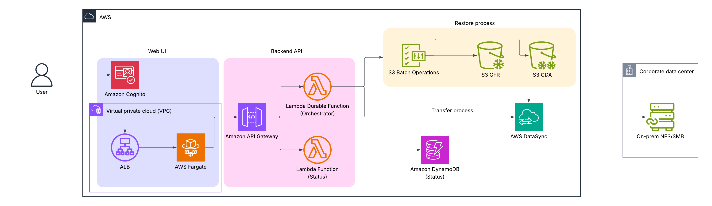
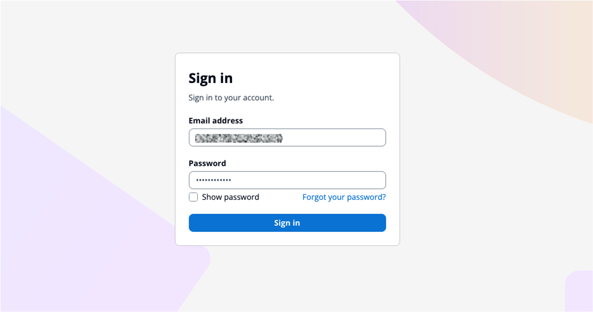
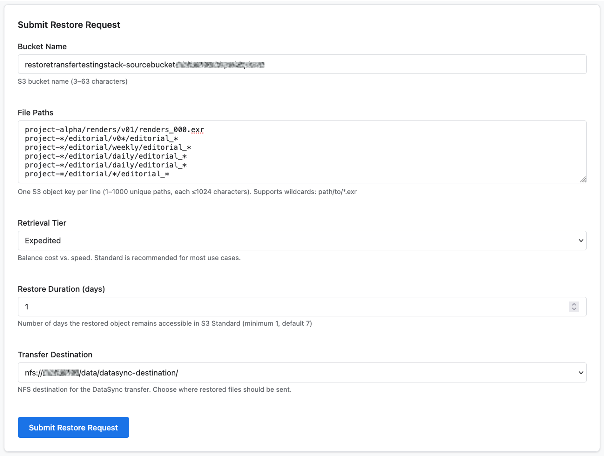
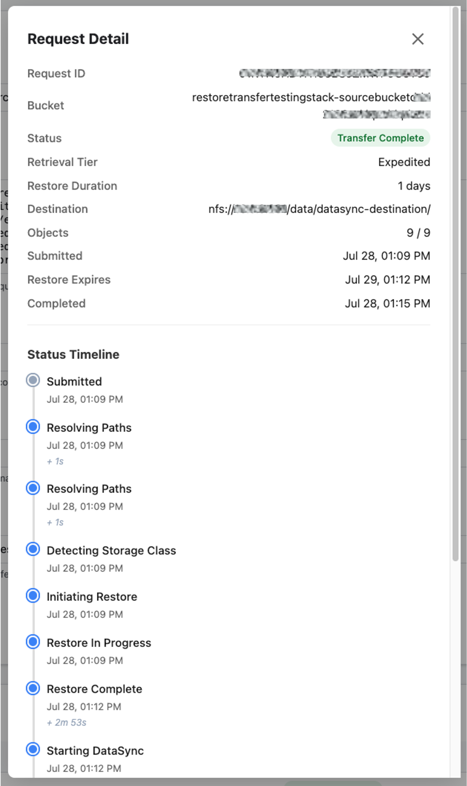

# Restore and transfer orchestrator

An AWS CDK application that orchestrates S3 Glacier restores and DataSync transfers. It provides a REST API and web UI for submitting restore requests, tracking their status, and automatically syncing specific restored objects to an on-premises NFS destination via AWS DataSync.

> **⚠️ Non-production sample:** This project is intended as an internal tool and reference architecture. It contains deliberate simplifications (e.g., wildcard S3 IAM permissions, predictable fallback resource names) that must be hardened before production use. See [SECURITY.md](SECURITY.md) for details and hardening recommendations.

## Architecture



The stack deploys six main components:

- **VPC Network** — VPC with private subnets, NAT Gateway, and VPC Endpoints for private AWS service connectivity (supports bring-your-own-VPC or auto-provisioning)
- **Persistence** — DynamoDB table for tracking restore request state with status timeline
- **Orchestrator** — Durable Lambda function (VPC-placed) that manages the multi-step restore workflow (detect storage class → initiate restore → monitor restore → start DataSync → monitor DataSync)
- **Auth** — Amazon Cognito User Pool with hosted UI for user authentication (authorization code grant with PKCE)
- **API** — Private REST API Gateway with Lambda integrations (VPC-placed) and Cognito authorizer, accessible only from within the VPC via VPC Endpoint
- **Web UI** — ECS Fargate service running nginx behind an internal ALB with HTTPS, serving the static web UI within the VPC

> **Network access:** This application is entirely VPC-private. There are no public-facing endpoints. Users must access the web UI from a VPC-connected workstation (e.g., via VPN, AWS Direct Connect, or a bastion host within the VPC).

### Orchestrator workflow

The orchestrator handles each request intelligently:

1. **Detect storage class** — Checks each object's storage class and current restore status via HeadObject
2. **Skip already-restored objects** — Objects with an active restore or in warm tiers skip straight to DataSync
3. **Initiate restores** — Only initiates restores for cold objects that need it (individual for ≤50, S3 Batch Operations for >50)
4. **Monitor restores** — Polls restore status with exponential backoff until completion or timeout
5. **Start DataSync with manifest** — Uploads a CSV manifest of the specific files to transfer, then starts a DataSync task execution scoped to only those files
6. **Monitor DataSync** — Polls execution status until completion

## Prerequisites

- [Node.js](https://nodejs.org/) >= 18.x
- [AWS CLI](https://docs.aws.amazon.com/cli/latest/userguide/getting-started-install.html) configured with appropriate credentials
- [AWS CDK CLI](https://docs.aws.amazon.com/cdk/v2/guide/cli.html) v2 (`npm install -g aws-cdk`)
- An AWS account with permissions to create Lambda, API Gateway, DynamoDB, S3, ECS, ELB, EC2 (VPC), Cognito, and DataSync resources
- An ACM certificate in the deployment region (for HTTPS on the internal ALB)
- (Optional) An existing VPC with at least 2 private subnets in separate AZs and NAT Gateway routing configured
- (Optional) A pre-configured AWS DataSync task (source S3 → destination NFS/S3)
- (Optional) An S3 bucket for staging batch operation manifests and DataSync manifests
- (Optional) An IAM role for S3 Batch Operations
- (Optional) An IAM role for DataSync to access the source bucket and manifest bucket

## Installation

```bash
# Clone the repository
git clone https://github.com/aws-samples/sample-glacier-restore-datasync-transfer-orchestrator.git
cd sample-glacier-restore-datasync-transfer-orchestrator

# Install dependencies
npm install
```

## Configuration

The stack uses environment variables to configure deployment. Set these before deploying:

| Variable | Description | Required |
|----------|-------------|----------|
| `ENV` | Target environment (`dev` or `prod`). Defaults to `dev`. | No |
| `CERTIFICATE_ARN` | ACM certificate ARN for the internal ALB HTTPS listener. Must be in the same region as the deployment. | Yes |
| `EXISTING_VPC_ID` | Existing VPC ID to use. When absent/empty, the stack creates a new VPC with private subnets and NAT Gateway. | No |
| `APP_URL` | Public URL users access the web UI through (e.g. `https://restore-tool.internal`). Used for Cognito callback/logout URLs and the front-end redirect URIs. When absent, the internal ALB DNS name is used. | No |
| `DATASYNC_TASK_ARN` | Default/fallback DataSync task ARN, used when a request does not specify a destination | No |
| `STAGING_BUCKET` | S3 bucket name for batch and DataSync manifests | Yes |
| `CDK_DEFAULT_ACCOUNT` | AWS account ID for deployment | Yes |
| `CDK_DEFAULT_REGION` | AWS region for deployment | Yes |
| `BATCH_ROLE_ARN` | IAM role ARN for S3 Batch Operations | Yes |
| `DATASYNC_S3_ROLE_ARN` | IAM role ARN for DataSync to access S3 (source + manifests); also used to create new DataSync tasks/locations dynamically | Yes |

> **Note on DataSync task resolution:** When a user selects a destination in the UI (via the `/datasync-destinations` endpoint), the orchestrator dynamically finds or creates a DataSync task matching the source bucket and chosen NFS destination. `DATASYNC_TASK_ARN` is only used as a fallback when no destination is specified in the request.

Example:

```bash
export ENV=dev
export CERTIFICATE_ARN=arn:aws:acm:us-west-2:123456789012:certificate/abc12345-6789-0abc-def0-123456789012
export EXISTING_VPC_ID=  # Leave empty to create a new VPC, or set to an existing VPC ID
export DATASYNC_TASK_ARN=arn:aws:datasync:us-west-2:123456789012:task/task-abc123  # optional fallback
export STAGING_BUCKET=my-staging-bucket
export CDK_DEFAULT_ACCOUNT=123456789012
export CDK_DEFAULT_REGION=us-west-2
export BATCH_ROLE_ARN=arn:aws:iam::123456789012:role/S3BatchOperationsRole
export DATASYNC_S3_ROLE_ARN=arn:aws:iam::123456789012:role/DataSyncS3Role
```

### ACM certificate

The internal ALB requires an ACM certificate for HTTPS termination. This is needed because the Cognito PKCE auth flow requires HTTPS callback URLs, and it encrypts traffic between the user's workstation and the ALB.

#### Option A: Self-signed certificate (simplest, no public domain needed)

This is the quickest path for internal tools. You generate a self-signed certificate, import it into ACM, and use it on the ALB. Browsers will show a security warning that users click through (acceptable for an internal tool with a known user base).

**1. Generate a self-signed certificate:**

```bash
# Create a private key
openssl genrsa -out alb-key.pem 2048

# Generate a self-signed certificate (valid for 365 days)
# Use any domain — it doesn't need to be real
openssl req -new -x509 -key alb-key.pem -out alb-cert.pem -days 365 \
  -subj "/CN=restore-tool.internal"
```

**2. Import into ACM:**

```bash
CERTIFICATE_ARN=$(aws acm import-certificate \
  --certificate fileb://alb-cert.pem \
  --private-key fileb://alb-key.pem \
  --region us-west-2 \
  --query "CertificateArn" --output text)

echo "Certificate ARN: $CERTIFICATE_ARN"
export CERTIFICATE_ARN
```

**3. Deploy the stack:**

```bash
cdk deploy RestoreTransferStack
```

**4. Access the app:**

Navigate to `https://<AlbDnsName>` from a VPC-connected workstation. Your browser will warn about the self-signed certificate — click through to proceed.

> **Renewal:** Imported certificates do not auto-renew. Before the cert expires (365 days), regenerate and re-import using `aws acm import-certificate --certificate-arn <existing-arn>` with the new cert files, then redeploy.

> **Suppress browser warnings (optional):** Install `alb-cert.pem` as a trusted CA certificate on client machines. On macOS: add it to Keychain Access and mark as "Always Trust". On Windows: import into "Trusted Root Certification Authorities". After this, browsers will accept the certificate without warnings.

#### Option B: ACM public certificate (requires a public domain you control)

If you own a public domain (e.g., `example.com`), you can issue a free, auto-renewing ACM public certificate. This avoids browser warnings since ACM public certs are trusted by all browsers.

**1. Request the certificate:**

```bash
CERTIFICATE_ARN=$(aws acm request-certificate \
  --domain-name "restore-tool.internal.example.com" \
  --validation-method DNS \
  --region us-west-2 \
  --query "CertificateArn" --output text)
```

**2. Validate via public DNS.** Add the ACM-provided CNAME record to your **public** hosted zone for `example.com`:

```bash
# Get the validation record
aws acm describe-certificate \
  --certificate-arn $CERTIFICATE_ARN \
  --query "Certificate.DomainValidationOptions[0].ResourceRecord"

# Add the CNAME to your public hosted zone (Route 53 example)
aws route53 change-resource-record-sets \
  --hosted-zone-id <PUBLIC_HOSTED_ZONE_ID> \
  --change-batch '{
    "Changes": [{
      "Action": "UPSERT",
      "ResourceRecordSet": {
        "Name": "<VALIDATION_NAME>",
        "Type": "CNAME",
        "TTL": 300,
        "ResourceRecords": [{"Value": "<VALIDATION_VALUE>"}]
      }
    }]
  }'

# Wait for validation (5–30 minutes)
aws acm wait certificate-validated --certificate-arn $CERTIFICATE_ARN
```

**3. Deploy the stack** with `export CERTIFICATE_ARN` set, then **create a private hosted zone** so VPC clients resolve the domain to the ALB:

```bash
ALB_DNS=$(aws cloudformation describe-stacks --stack-name RestoreTransferStack \
  --query "Stacks[0].Outputs[?OutputKey=='AlbDnsName'].OutputValue" --output text)

# Create private hosted zone
ZONE_ID=$(aws route53 create-hosted-zone \
  --name "internal.example.com" \
  --caller-reference "$(date +%s)" \
  --vpc VPCRegion=us-west-2,VPCId=<YOUR_VPC_ID> \
  --hosted-zone-config PrivateZone=true \
  --query "HostedZone.Id" --output text)

# Point the domain at the ALB
aws route53 change-resource-record-sets \
  --hosted-zone-id $ZONE_ID \
  --change-batch '{
    "Changes": [{
      "Action": "UPSERT",
      "ResourceRecordSet": {
        "Name": "restore-tool.internal.example.com",
        "Type": "CNAME",
        "TTL": 300,
        "ResourceRecords": [{"Value": "'$ALB_DNS'"}]
      }
    }]
  }'
```

Users access the app at `https://restore-tool.internal.example.com` with no browser warnings.


### Using an existing VPC

If your organization has a shared VPC (e.g., connected via Transit Gateway or Direct Connect), set `EXISTING_VPC_ID` to reuse it:

```bash
export EXISTING_VPC_ID=vpc-0abc1234def56789a
```

Both the `RestoreTransferStack` and `RestoreTransferTestingStack` read this variable. When set, both stacks deploy into the same VPC, eliminating the need for VPC peering between them.

Requirements for the existing VPC:
- At least 2 private subnets in separate Availability Zones (for `RestoreTransferStack`)
- At least 1 public subnet (for the testing stack's EC2 instances — NFS server and DataSync agents)
- NAT Gateway routing configured for outbound internet access from private subnets
- Gateway VPC Endpoints for S3 and DynamoDB should already exist (the stack skips creating them for existing VPCs to avoid conflicts)
- The `RestoreTransferStack` will still create interface VPC Endpoints (execute-api, lambda, logs, monitoring, sts) and security groups within the provided VPC

### Access URL and Cognito redirects (`APP_URL`)

The web UI is fronted by an internal ALB. By default, the Cognito callback/logout URLs and the front-end redirect URIs are set to the ALB's own DNS name. That works only if your workstation can both **resolve** and **reach** the ALB DNS name.

In many private networks the ALB DNS name does not resolve from client machines: internal ALB names are published in public DNS but point to private IPs (`10.x.x.x`), and corporate resolvers/VPNs frequently drop those answers (DNS-rebinding protection) or don't forward `amazonaws.com` lookups. In that case you access the app through a custom domain instead (e.g. `restore-tool.internal`), typically via a Route 53 private hosted zone or a local hosts entry.

When you access the app through a custom domain, set `APP_URL` to that domain so authentication works correctly:

```bash
export APP_URL=https://restore-tool.internal
```

`APP_URL` controls:
- The Cognito User Pool Client **callback and logout URLs** (so Cognito redirects the browser back to a URL it can resolve and that matches the TLS certificate)
- The `redirectUri` / `logoutUri` injected into the container's `config.js`
- The API Gateway CORS allowed origin

If `APP_URL` is omitted, the stack falls back to the internal ALB DNS name (original behavior). The value should match the domain on your ACM certificate — otherwise the browser shows a certificate name mismatch.

> **Tip:** The custom domain must resolve to the ALB from the client. The durable option is a Route 53 private hosted zone for the domain with an alias record to the ALB, with your VPN using the VPC resolver. For quick testing, a hosts-file entry pointing the domain at an ALB private IP works, but ALB node IPs can change over time.

## Deployment

### First-time setup

If this is your first CDK deployment in the target account/region, bootstrap the environment:

```bash
cdk bootstrap aws://<ACCOUNT_ID>/<REGION>
```

### Testing infrastructure (optional — if you don't have DataSync resources)

If you don't already have a DataSync task, staging bucket, S3 Batch Operations role, and DataSync S3 role, you can deploy the optional `RestoreTransferTestingStack` to provision all of these. Skip this section if you already have these resources.

The testing stack creates:

- VPC with public subnet (or uses an existing VPC if `EXISTING_VPC_ID` is set)
- Source S3 bucket (with Glacier lifecycle rule)
- Staging S3 bucket
- NFS server EC2 instance
- DataSync agent EC2 instance
- DataSync task, locations, and IAM roles
- S3 Batch Operations role

> **Shared VPC:** If you set `EXISTING_VPC_ID`, both the testing stack and the main `RestoreTransferStack` deploy into the same VPC. This avoids needing VPC peering between two separate VPCs. The existing VPC must have at least one public subnet (for the DataSync agent and NFS server instances).

#### Two-phase deployment

**Phase 1** — Deploy without activation key to stand up EC2 instances:

```bash
export CDK_DEFAULT_ACCOUNT=$(aws sts get-caller-identity --query Account --output text)
export CDK_DEFAULT_REGION=us-west-2
# Optional: export EXISTING_VPC_ID=vpc-xxx to share a VPC with RestoreTransferStack

cdk deploy RestoreTransferTestingStack \
  --parameters ActivationCidr=$(curl -s ifconfig.me)/32
```

**Phase 2** — Activate the DataSync agents, then redeploy:

**Basic mode agent** — activate via curl (port 80):

```bash
# Get the Basic mode activation key (use the agent public IP from Phase 1 outputs)
curl -v "http://<basic-agent-public-ip>/?gatewayType=SYNC&activationRegion=us-west-2&redirect_type=TEXT"
# The activation key is in the Location header of the 302 response
```

**Enhanced mode agent** — activate via the DataSync console (the v3 agent does not support curl-based activation):

1. Open the [DataSync console](https://console.aws.amazon.com/datasync/) → **Agents** → **Create agent**
2. For **Service endpoint**, choose **Public service endpoints**
3. For **Activation key**, choose **Automatically get the activation key from your agent**
4. Enter the Enhanced agent's public IP (from Phase 1 outputs: `DataSyncEnhancedAgentPublicIp`)
5. Click **Get key** — the console will retrieve the key via your browser's connection to the agent on port 80
6. Copy the activation key from the page (you'll cancel out of the console wizard — we just need the key)

Alternatively, use SSM Session Manager to connect to the Enhanced agent instance and retrieve the key from the agent's local console menu.

```bash
# Redeploy with the key(s)
cdk deploy RestoreTransferTestingStack \
  --parameters ActivationKey=XXXXX-XXXXX-XXXXX-XXXXX-XXXXX \
  --parameters EnhancedActivationKey=YYYYY-YYYYY-YYYYY-YYYYY-YYYYY \
  --parameters ActivationCidr=$(curl -s ifconfig.me)/32
```

> **Note:** The Enhanced agent activation is optional. If you only need Basic mode DataSync tasks, omit `EnhancedActivationKey`. The Enhanced mode task and its resources are only created when both activation keys are provided.

#### Set environment variables from testing stack outputs

```bash
export DATASYNC_TASK_ARN=$(aws cloudformation describe-stacks --stack-name RestoreTransferTestingStack --query "Stacks[0].Outputs[?OutputKey=='DataSyncTaskArnOutput'].OutputValue" --output text)
export STAGING_BUCKET=$(aws cloudformation describe-stacks --stack-name RestoreTransferTestingStack --query "Stacks[0].Outputs[?OutputKey=='StagingBucketNameOutput'].OutputValue" --output text)
export BATCH_ROLE_ARN=$(aws cloudformation describe-stacks --stack-name RestoreTransferTestingStack --query "Stacks[0].Outputs[?OutputKey=='BatchRoleArnOutput'].OutputValue" --output text)
export DATASYNC_S3_ROLE_ARN=$(aws cloudformation describe-stacks --stack-name RestoreTransferTestingStack --query "Stacks[0].Outputs[?OutputKey=='DataSyncS3RoleArnOutput'].OutputValue" --output text)
```

### Deploy

```bash
# Deploy the stack
cdk deploy RestoreTransferStack
```

The deploy command will output:
- `ApiEndpoint` — The Private API Gateway URL (accessible only from within the VPC)
- `AlbDnsName` — The internal ALB DNS name (use this to access the web UI from a VPC-connected workstation)
- `CognitoUserPoolId` — The Cognito User Pool ID
- `CognitoClientId` — The Cognito User Pool Client ID

> **Accessing the application:** Since the ALB is internal (no public IP), you must access the web UI from a machine connected to the VPC — for example, via AWS VPN Client, AWS Direct Connect, a bastion host, or AWS Cloud9 within the VPC. Navigate to your access URL in the browser: `https://<AlbDnsName>` if you can resolve/reach the ALB name directly, or your custom domain (e.g. `https://restore-tool.internal`) if you set [`APP_URL`](#access-url-and-cognito-redirects-app_url). The access URL must match your ACM certificate and the configured `APP_URL`, otherwise Cognito login will fail to redirect back.

### Post-deployment: create a Cognito user

Self-sign-up is disabled, so you need to create users via the AWS CLI or Console:

```bash
# Create a user
aws cognito-idp admin-create-user \
  --user-pool-id <USER_POOL_ID> \
  --username user@example.com \
  --user-attributes Name=email,Value=user@example.com \
  --temporary-password 'TempPass1!'

# Set a permanent password (skip the force-change-password flow)
aws cognito-idp admin-set-user-password \
  --user-pool-id <USER_POOL_ID> \
  --username user@example.com \
  --password 'YourSecureP@ss1' \
  --permanent
```

The User Pool ID and Client ID are available in the stack outputs (`CognitoUserPoolId` and `CognitoClientId`).

### Deploy to a specific environment

```bash
# Deploy to production
ENV=prod cdk deploy RestoreTransferStack
```

## Upload test data

A helper script uploads sample files to various Glacier storage classes. It supports configurable file counts, folder nesting depth, and storage class selection — useful for testing glob patterns and batch operation thresholds.

```bash
SOURCE_BUCKET=$(aws cloudformation describe-stacks --stack-name RestoreTransferTestingStack \
  --query "Stacks[0].Outputs[?OutputKey=='SourceBucketNameOutput'].OutputValue" --output text)

./scripts/upload-test-data.sh "$SOURCE_BUCKET"
```

**Options:**

| Flag | Description | Default |
|------|-------------|---------|
| `-n, --num-files <count>` | Number of files per storage class | 3 |
| `-d, --depth <levels>` | Folder nesting depth (2–4 levels) | 2 |
| `-s, --size <mb>` | Size of each file in MB | 1 |
| `--flat` | No nested folders — all files at top level | off |
| `--classes <list>` | Comma-separated storage classes | `GLACIER,GLACIER_IR,DEEP_ARCHIVE,INTELLIGENT_TIERING` |

**Examples:**

```bash
# Deep nesting for glob pattern testing
./scripts/upload-test-data.sh "$SOURCE_BUCKET" -n 10 -d 4

# Flat structure, single class
./scripts/upload-test-data.sh "$SOURCE_BUCKET" -n 5 --flat --classes GLACIER

# Large batch to exceed the 50-object threshold (triggers S3 Batch Operations)
./scripts/upload-test-data.sh "$SOURCE_BUCKET" -n 15 -d 3
```

## Testing a transfer in the UI

Once the testing stack and main stack are deployed, you can submit a restore-and-transfer request through the web UI. This walkthrough uses the test environment resources.

### 1. Log in

Open the Web UI by navigating to your access URL in a browser on a VPC-connected workstation — `https://<AlbDnsName>` from the stack outputs, or your custom domain (e.g. `https://restore-tool.internal`) if you set [`APP_URL`](#access-url-and-cognito-redirects-app_url). You'll be redirected to the Cognito hosted login page. Sign in with the user you created in the [post-deployment step](#post-deployment-create-a-cognito-user).

> **If the Cognito redirect hangs after login:** the app is likely redirecting to a URL your browser can't resolve (usually the raw ALB DNS name). Set `APP_URL` to the domain you actually access the app through and redeploy — see [Access URL and Cognito redirects](#access-url-and-cognito-redirects-app_url).



### 2. Fill out the restore request form

| Field | What to enter |
|-------|---------------|
| **S3 Bucket** | The source bucket name from the testing stack (the `SourceBucketNameOutput` value) |
| **File Paths** | One path per line. Use exact keys (e.g., `project-alpha/renders/v01/renders_000.exr`) or glob patterns (e.g., `project-alpha/renders/v01/*`). These should match files you uploaded with the test data script. |
| **Retrieval Tier** | `Standard` is a good default for testing. `Expedited` is faster (minutes) but only works for Glacier, not Deep Archive. `Bulk` is cheapest but can take multiple hours, depending on the tier. |
| **Restore Duration** | Number of days the restored copies remain accessible. Use a low value like `1` for testing. |
| **Transfer Destination** | Select an NFS destination from the dropdown. The testing stack creates two: `/data/datasync-destination` and `/data/datasync-destination-2`. |

> **Glob pattern limitations:** Only single-level `*` wildcards are supported (e.g., `renders/*.exr` matches files directly in `renders/`). Recursive patterns (`**`) and single-character wildcards (`?`) are not supported. To match files in nested subdirectories, submit separate patterns for each level (e.g., `renders/shot-01/*.exr`, `renders/shot-02/*.exr`) or use exact paths.



### 3. Submit and monitor

Click **Submit Restore Request**. The request appears in the dashboard below the form with a status of **Submitted**. The dashboard auto-refreshes every 10 seconds.

The request progresses through these stages:

1. **Resolving Paths** — Glob patterns are expanded to concrete S3 keys
2. **Detecting Storage Class** — Each object is checked for its current storage tier
3. **Initiating Restore** — Glacier restore requests are issued
4. **Restore In Progress** — Polling until objects are restored (duration depends on retrieval tier)
5. **Starting DataSync** — A manifest is uploaded and a DataSync task execution starts
6. **DataSync In Progress** — Transfer is running to the NFS destination
7. **Transfer Complete** — All objects have been transferred

### 4. View request details

Click any row in the dashboard to open the detail panel. This shows:

- Full request parameters (bucket, tier, destination)
- Object progress (restored count / total)
- Status timeline with timestamps and duration between each step
- A link to download the transfer manifest (once generated)



### 5. Verify on the NFS server

Connect to the NFS server instance using SSM Session Manager (no SSH or key pair is configured on the instance).

**Option A — From the AWS Console:**

1. Open the [EC2 Instances console](https://console.aws.amazon.com/ec2/home#Instances)
2. Find the instance named `RestoreTransferTestingStack/NfsServer`
3. Select it → **Connect** → **SSM Session Manager** tab → **Connect**
4. In the shell session, run: `ls /data/datasync-destination/`

> **Note:** Your IAM user/role needs the `ssm:StartSession` permission on the instance. See the [Session Manager prerequisites](https://docs.aws.amazon.com/systems-manager/latest/userguide/session-manager-prerequisites.html) for required IAM policies.

**Option B — From the CLI (requires the [Session Manager plugin](https://docs.aws.amazon.com/systems-manager/latest/userguide/session-manager-working-with-install-plugin.html)):**

```bash
# Get the NFS server instance ID
NFS_INSTANCE_ID=$(aws ec2 describe-instances \
  --filters "Name=tag:Name,Values=RestoreTransferTestingStack/NfsServer" \
             "Name=instance-state-name,Values=running" \
  --query "Reservations[0].Instances[0].InstanceId" --output text)

# Start a session
aws ssm start-session --target "$NFS_INSTANCE_ID"

# Once connected, check the destination directory
ls /data/datasync-destination/
```

### Tips for testing

- **Quick iteration:** Use `Expedited` tier with Glacier Flexible Retrieval objects for restores that complete in 1–5 minutes.
- **Test batch operations:** Upload 50+ files with the test data script to trigger S3 Batch Operations instead of individual `RestoreObject` calls.
- **Test glob patterns:** Use deep nesting (`-d 4`) when uploading test data, then submit a request with patterns like `glacier/depth-2/*.dat` to match files at a specific level.
- **Test multiple destinations:** Submit separate requests targeting each NFS destination to verify the dynamic task resolution logic.

## Development

```bash
# Watch mode — recompile on file changes
npm run watch

# Run unit tests
npm run test

# Synthesize and check for drift
cdk diff
```

### Local UI development

The web UI is now served from a container inside the VPC. For local development, you can run the container locally with Docker:

```bash
# Build config from stack outputs
API_URL=$(aws cloudformation describe-stacks --stack-name RestoreTransferStack \
  --query "Stacks[0].Outputs[?OutputKey=='ApiEndpoint'].OutputValue" --output text)
USER_POOL_ID=$(aws cloudformation describe-stacks --stack-name RestoreTransferStack \
  --query "Stacks[0].Outputs[?OutputKey=='CognitoUserPoolId'].OutputValue" --output text)
CLIENT_ID=$(aws cloudformation describe-stacks --stack-name RestoreTransferStack \
  --query "Stacks[0].Outputs[?OutputKey=='CognitoClientId'].OutputValue" --output text)
ALB_DNS=$(aws cloudformation describe-stacks --stack-name RestoreTransferStack \
  --query "Stacks[0].Outputs[?OutputKey=='AlbDnsName'].OutputValue" --output text)
COGNITO_DOMAIN=$(aws cognito-idp describe-user-pool \
  --user-pool-id "$USER_POOL_ID" \
  --query "UserPool.Domain" --output text)

# Run the container locally
docker build -t restore-ui src/web-ui/
docker run -p 8080:80 \
  -e API_URL="${API_URL%/}" \
  -e COGNITO_USER_POOL_ID="$USER_POOL_ID" \
  -e COGNITO_CLIENT_ID="$CLIENT_ID" \
  -e COGNITO_DOMAIN="https://${COGNITO_DOMAIN}.auth.${CDK_DEFAULT_REGION}.amazoncognito.com" \
  -e REDIRECT_URI="http://localhost:8080" \
  -e LOGOUT_URI="http://localhost:8080" \
  restore-ui
```

Alternatively, serve the static files directly:

```bash
cat > src/web-ui/config.js << EOF
window.__CONFIG__ = {
  "apiUrl": "${API_URL%/}",
  "cognito": {
    "userPoolId": "${USER_POOL_ID}",
    "clientId": "${CLIENT_ID}",
    "domain": "https://${COGNITO_DOMAIN}.auth.${CDK_DEFAULT_REGION}.amazoncognito.com",
    "redirectUri": "http://localhost:8080",
    "logoutUri": "http://localhost:8080"
  }
};
EOF

python3 -m http.server 8080 --directory src/web-ui
```

> **Note:** For local development, you must add `http://localhost:8080` to the Cognito User Pool Client's allowed callback and logout URLs in the AWS Console. The Private API Gateway is only reachable from within the VPC — local API calls will fail unless you're connected to the VPC (e.g., via VPN).

## Project structure

```
├── bin/                                # CDK app entry point
├── lib/
│   ├── config/                         # Environment configuration
│   ├── constructs/                     # CDK construct definitions
│   │   ├── api-construct.ts            # Private REST API with Cognito authorizer
│   │   ├── auth-construct.ts           # Cognito User Pool, Client & Hosted UI
│   │   ├── orchestrator-construct.ts   # Durable workflow Lambda (VPC-placed)
│   │   ├── persistence-construct.ts    # DynamoDB table
│   │   ├── vpc-construct.ts            # VPC, subnets, NAT, VPC Endpoints, SGs
│   │   └── vpc-web-ui-construct.ts     # ECS Fargate + internal ALB (HTTPS)
│   ├── restore-transfer-stack.ts       # Main application stack
│   └── testing-infrastructure-stack.ts # Optional test infrastructure
├── scripts/                            # Helper scripts (test data upload)
├── src/
│   ├── api/                            # API Lambda handlers
│   ├── orchestrator/                   # Durable workflow Lambda + steps
│   ├── shared/                         # Shared types, constants, validation
│   └── web-ui/                         # Web UI (Dockerfile, static assets, entrypoint)
└── test/                               # Unit tests
```

## Useful commands

| Command | Description |
|---------|-------------|
| `npm run build` | Compile TypeScript to JavaScript |
| `npm run watch` | Watch for changes and recompile |
| `npm run test` | Run Jest unit tests |
| `cdk synth` | Emit the synthesized CloudFormation template |
| `cdk diff` | Compare deployed stack with current state |
| `cdk deploy RestoreTransferStack` | Deploy the main application stack |
| `cdk deploy RestoreTransferTestingStack` | Deploy the testing infrastructure |
| `cdk destroy RestoreTransferStack` | Remove the main stack |
| `cdk destroy RestoreTransferTestingStack` | Remove the testing infrastructure |

## Cleanup

To tear down all deployed resources:

```bash
cdk destroy RestoreTransferStack
cdk destroy RestoreTransferTestingStack
```

Note: Destroy the main stack first, then the testing stack. The testing stack includes DynamoDB tables and S3 buckets that will be deleted along with their data.

## Security

This project has documented security trade-offs and production hardening recommendations. See [SECURITY.md](SECURITY.md) for:

- Known IAM permission scoping decisions and how to tighten them
- Predictable resource name risks and mitigations
- WAF and other defense-in-depth recommendations

To report a security issue, see [CONTRIBUTING](CONTRIBUTING.md#security-issue-notifications).

## License

This library is licensed under the MIT-0 License. See the LICENSE file.